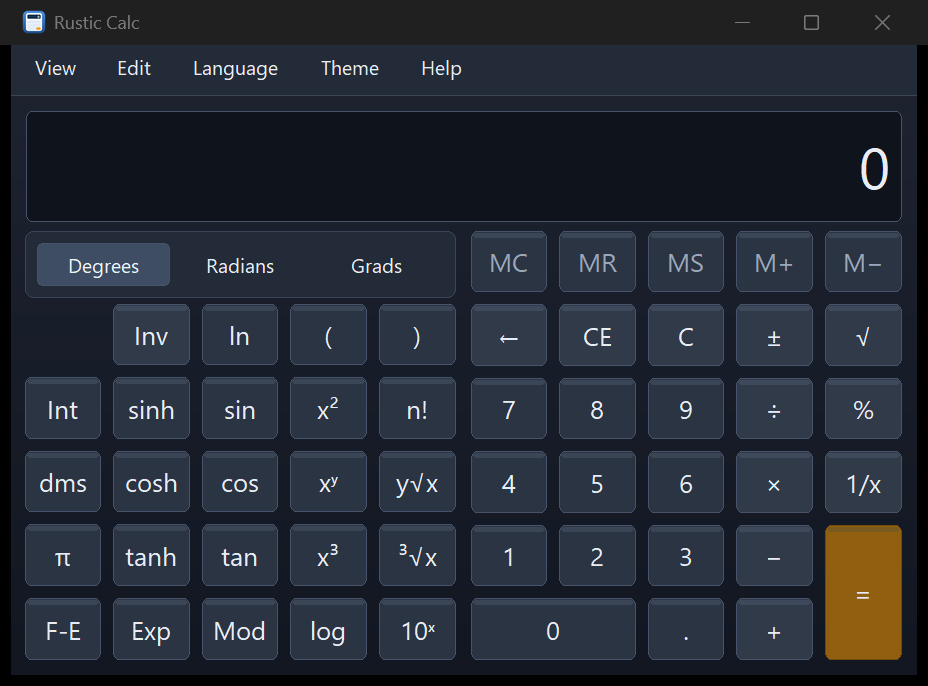

# Rustic Calc

[](https://github.com/boogy777-lgtm/rustic-calc/actions/workflows/ci.yml)
[](LICENSE)

A small native Windows calculator written in Rust, using Win32/GDI instead of
a browser engine or a GPU UI framework. MIT licensed. Russian and English UI.



## Download

Get the latest build from [Releases](https://github.com/boogy777-lgtm/rustic-calc/releases):

- **`RusticCalc.exe`** — one portable executable; no install required.
- **`RusticCalc-Setup.exe`** — per-user Windows installer with Start menu shortcut,
  optional desktop shortcut and optional `calc` command integration.
- `SHA256SUMS.txt` — hashes for verification.

The binaries are currently **unsigned**: Windows SmartScreen may display a warning.
Verify the download source and SHA-256. Do not disable security software globally.

## Supported platforms

| Platform | Status |
| --- | --- |
| Windows 10/11 x64 | Official build and installer |
| Windows x86 / native ARM64 | Not released/tested yet; PRs welcome |
| Linux | Not supported; a native UI backend is needed. PRs welcome |
| macOS | Not supported; a native UI backend is needed. PRs welcome |

The current frontend uses Win32/GDI. A Windows executable is **not** a Linux or
macOS build; Wine/emulation is not part of the support promise. Portability PRs
should follow [the module contract](docs/MODULE_SDK.md), keep the mathematical
engine independent, and discuss any dependency changes before implementation.

## Features

- Standard, scientific, programmer and statistics calculators.
- Unit/process/DCS conversion, date calculations and four worksheets.
- 64-bit programmer mode with fixed two-row bit layout.
- Mortgage, vehicle lease, MPG and L/100 km worksheets, including inverse targets.
- DCS loop-resistor helper with E24 suggestion and power estimate.
- System, light and dark themes; shared selection/focus styling.
- Per-monitor DPI scaling, keyboard shortcuts and screenshot CLI.

`Ctrl+1`…`Ctrl+0` select the ten modes; `Ctrl+U`/`Ctrl+E` are aliases for units/dates.
Forms support Tab and Enter. Native inputs retain normal editing/clipboard behavior.

```bat
RusticCalc.exe --mode scientific --lang en --theme dark
RusticCalc.exe --mode programmer --screenshot programmer.png
```

Modes: `standard`, `scientific`, `programmer`, `statistics`, `unit`, `date`,
`mortgage`, `lease`, `mpg`, `l100`. Languages: `ru` (default), `en`.
Themes: `system` (default), `white`, `dark`.

## Build and test

Requires Windows, Git, Rust/rustup, Visual Studio Build Tools (MSVC x64) and a
Windows SDK including `rc.exe`. The Rust version is pinned in `rust-toolchain.toml`.

```powershell
cargo fmt --check
python tools/check_project.py
cargo test --locked
cargo build --release --locked
```

The internal build filename remains `target/x86_64-pc-windows-msvc/release/calc1.exe`
for compatibility with existing scripts. Release packaging renames that same
binary to `RusticCalc.exe`; this is not a second application.

Only runtime dependency: **`windows-sys 0.59`**. Release builds use a portable
x86-64 baseline, not `target-cpu=native`.

## CMD integration

Use `scripts\setup-calc.cmd Install` from the source checkout, or opt into the
installer's CMD task. The mapping is per-user, reversible, and never replaces
System32 files. See [scripts/README.md](scripts/README.md) for limitations and removal.

## Contributing and LLM-assisted work

Start with [CONTRIBUTING.md](CONTRIBUTING.md), [AGENTS.md](AGENTS.md),
[architecture](docs/ARCHITECTURE.md), [module SDK](docs/MODULE_SDK.md) and
[release procedure](docs/RELEASING.md). New backends/modules are welcome; do not
claim unsupported platforms or unverified test results.

This project is not affiliated with Microsoft. It ships no Microsoft executable,
MUI/resource dump or decompiled source. See [NOTICE.md](NOTICE.md).
